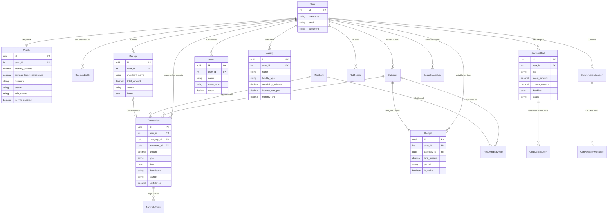
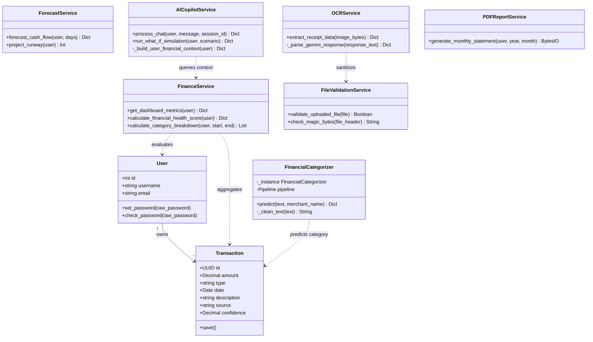
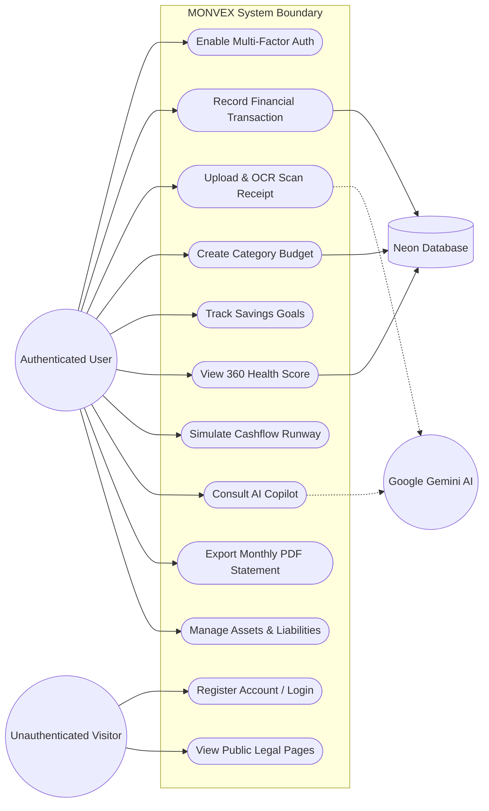
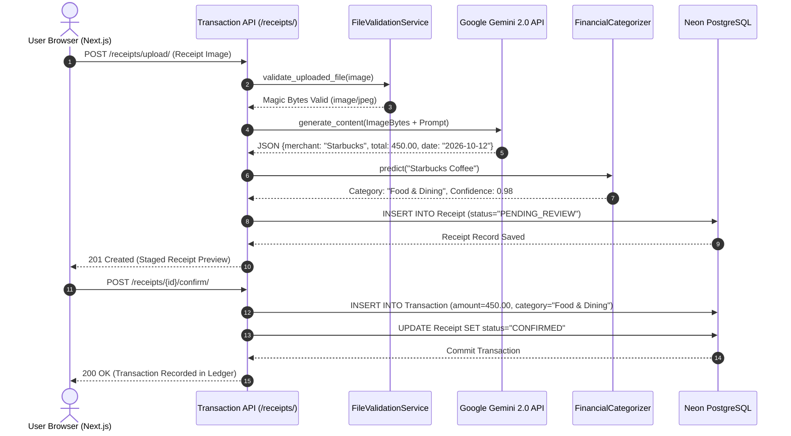
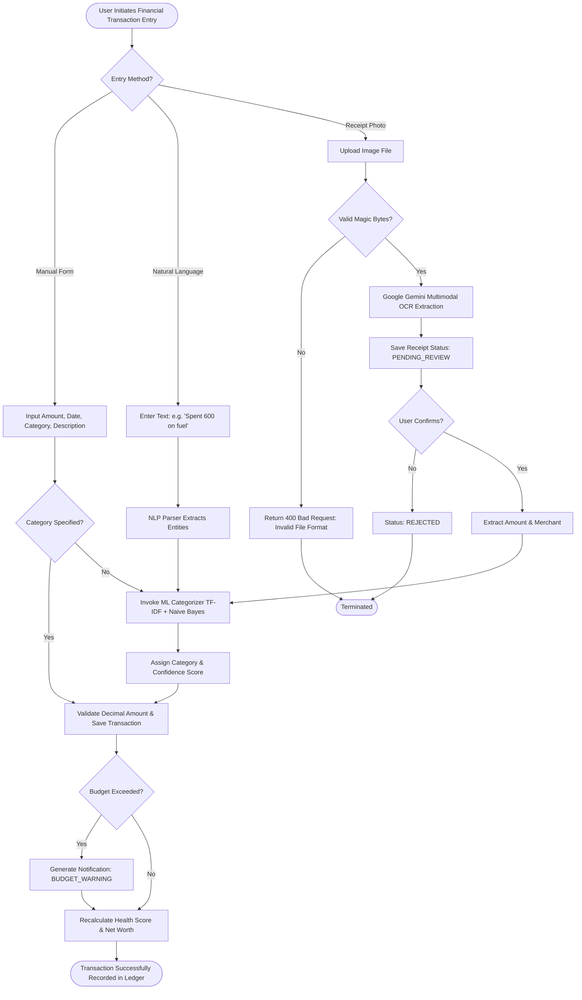

# MONVEX Conceptual Models & Diagram Specifications

> **Dossier Document:** 07  
> **Source Verification Status:** `[V-SRC]` & `[V-TST]`  
> **Academic Chapter Mapping:** Chapter 3.6 (3.6.1 through 3.6.6)  

---

## 1. Overview of Required Conceptual Models

The college syllabus prescribed in `Format for Final Project Documentation Sem6.pdf` (Section 3.6) mandates six conceptual models:
1. **Data Flow Diagram (DFD):** Context Level (Level 0) and Functional Decomposition (Level 1).
2. **Entity-Relationship Diagram (ERD):** Complete schema representation with Crow's Foot notation.
3. **Class Diagram:** High-level object model showing models, services, and relationships.
4. **Use Case Diagram:** Actors, boundaries, and primary business use cases.
5. **Sequence Diagram:** Time-ordered message exchange for core transaction & AI workflow.
6. **System Flowchart:** Decision-tree and logical processing flow.

---

## 2. Model 1: Data Flow Diagram (DFD 3.6.1)

### 2.1 Level 0: Context-Level DFD
```
+------------------+                    Credentials / Transactions / Receipts                   +------------------+
|                  | ------------------------------------------------------------------------> |                  |
|                  | <------------------------------------------------------------------------ |                  |
|                  |                       Financial Insights / Charts / PDF Reports           |                  |
|                  |                                                                           |                  |
|                  |                     OAuth Identity Token / Authentication Callback         |      MONVEX      |
|   SYSTEM USER    | <======================================================================== |    FINANCIAL     |
|                  |                                                                           |   INTELLIGENCE   |
|                  |                     Multimodal Image Payload / Natural Language Prompts   |      SYSTEM      |
|                  | ------------------------------------------------------------------------> |                  |
|                  | <------------------------------------------------------------------------ |                  |
|                  |                       Structured Receipt OCR / AI Copilot Advice          |                  |
+------------------+                                                                           +------------------+
                                                                                                  |      ^
                                                             Structured JSON Context / Image Data |      | Inferred JSON
                                                                                                  v      |
                                                                                               +------------------+
                                                                                               |  GOOGLE GEMINI   |
                                                                                               |    AI ENGINE     |
                                                                                               +------------------+
```

### 2.2 Level 1: Functional Decomposition DFD
* **Process 1.0 (Identity & Access Management):** Ingests credentials; validates against `D1: User Store`; outputs JWT access & refresh tokens.
* **Process 2.0 (Transaction Ingestion & ML Categorization):** Ingests manual, NLP, or receipt entries; invokes `FinancialCategorizer`; stores in `D2: Transaction Ledger`.
* **Process 3.0 (Budgeting & Milestone Enforcement):** Reads `D2: Transaction Ledger` and `D3: Budget Store`; calculates consumed percentage; issues notifications to `D4: Alert Store`.
* **Process 4.0 (Financial Analytics & Health Scoring):** Ingests historical transactions, asset valuations (`D5: Net Worth Store`); executes 4-pillar health score algorithm; outputs score (0–100) and forecast runway.
* **Process 5.0 (AI Copilot & Conversational Reasoning):** Retrieves isolated context from `D2`, `D3`, `D5`; invokes Google Gemini API; returns contextual financial advice; stores conversation in `D6: AI Session Store`.
* **Process 6.0 (PDF Statement & Export Service):** Aggregates period records from `D2` and `D3`; streams binary ReportLab PDF document to user.

---

## 3. Model 2: Entity-Relationship Diagram (ERD 3.6.2)



---

## 4. Model 3: System Class Diagram (3.6.3)



---

## 5. Model 4: System Use Case Diagram (3.6.4)



---

## 6. Model 5: System Sequence Diagram (3.6.5)

### Traced Scenario: Multimodal Receipt Upload, OCR, & Automatic Ledger Conversion


---

## 7. Model 6: System Flowchart (3.6.6)


