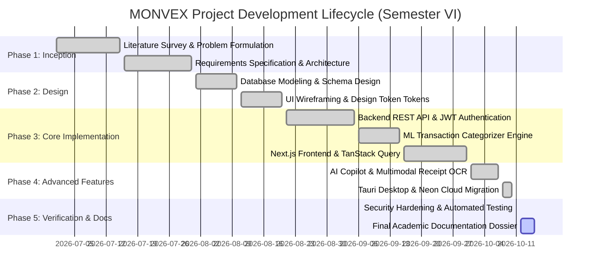

# MONVEX Requirements Catalog & System Analysis

> **Dossier Document:** 04  
> **Source Verification Status:** `[V-SRC]` & `[V-TST]`  
> **Academic Chapter Mapping:** Chapter 3.1, Chapter 3.2, Chapter 3.3, Chapter 3.4, Chapter 3.5  

---

## 1. Problem Definition (Chapter 3.1)

### 1.1 Limitations of the Existing / Traditional Approach
1. **Manual Data Entry Friction:** Users relying on spreadsheets or basic expense-tracking apps must manually type every merchant, category, and tax figure. This leads to high abandonment rates and incomplete ledgers.
2. **Disconnected Financial Silos:** Banking records, paper receipts, investment portfolios, and debt schedules exist across disparate systems without unified net worth visibility.
3. **Absence of Intelligent Categorization:** Static rule-based systems fail to generalize variations in merchant names (e.g., "AMZN Mktp" vs "Amazon India"), requiring constant manual re-tagging.
4. **Lack of Prescriptive Financial Guidance:** Traditional software records historical spending passively but fails to explain *why* overspending occurred or model *what-if* scenarios (e.g., extra loan prepayments or dining budget reductions).
5. **Insecure Storage & Privacy Concerns:** Many consumer apps aggregate sensitive credentials insecurely or leak financial records to third-party ad brokers.

### 1.2 Proposed MONVEX Solution
MONVEX solves these deficiencies through an AI-powered personal financial intelligence architecture:
* **Automated OCR & NLP Ingestion:** Paper receipts are converted to structured transactions using multimodal AI, while natural language sentences are parsed into ledger entries.
* **Machine Learning Categorization:** A Scikit-learn TF-IDF Naive Bayes pipeline automatically predicts categories with confidence scoring.
* **Unified Financial Health Score:** An algorithmic 0–100 wellness index objectively evaluates savings rate, budget discipline, debt burden, and emergency runway.
* **Interactive AI Financial Copilot:** A multi-turn conversational agent (Google Gemini 2.0) that reasons over the user's isolated ledger data to provide actionable insights, trend explanations, and "What-If" simulations.
* **Hardened Security Architecture:** Stateless JWT with HttpOnly cookie rotation, TOTP multi-factor authentication, database-level tenant isolation, and binary magic-byte upload validation.

---

## 2. Functional Requirements Catalog (Chapter 3.2)

### FR-01: User Registration & Identity Provisioning
* **Requirement:** The system shall allow new users to register using an email address, username, and password, automatically provisioning a profile with default financial categories.
* **Actor:** Unauthenticated Visitor.
* **Preconditions:** Valid email format; password meeting complexity requirements (minimum 8 characters).
* **Expected Behavior:** System creates `auth.User`, generates linked `Profile`, seeds default categories via `user_init_service.py`, and returns 201 Created.
* **Supporting Files:** `apps/authentication/views.py`, `apps/authentication/serializers.py`, `services/user_init_service.py`.
* **Acceptance Criteria:** Duplicate email or username rejected with 400 Bad Request; password stored with Argon2/PBKDF2 hash.
* **Test Case:** `test_standard_auth.py::test_user_registration_success`.
* **Status:** `[V-TST]` (PASS).

### FR-02: Secure User Authentication & Token Issuance
* **Requirement:** The system shall authenticate users using credentials, issuing a short-lived JWT access token in the response body and a secure HttpOnly refresh token cookie.
* **Actor:** Registered User.
* **Preconditions:** Active user account; correct password.
* **Expected Behavior:** System issues 60-minute access token and sets 7-day HttpOnly `monvex_refresh_token` cookie.
* **Supporting Files:** `apps/authentication/views.py::CustomLoginView`, `monvex/settings.py`.
* **Acceptance Criteria:** Invalid credentials return 401 Unauthorized; token contains user UUID and role claims.
* **Test Case:** `test_cookie_auth.py::test_login_sets_httponly_cookie`.
* **Status:** `[V-TST]` (PASS).

### FR-03: Multi-Factor Authentication (TOTP 2FA)
* **Requirement:** The system shall allow users to enable RFC 6238 TOTP two-factor authentication using authenticator apps, requiring a 6-digit TOTP code during login.
* **Actor:** Authenticated User.
* **Preconditions:** Active user session.
* **Expected Behavior:** System generates a base32 TOTP secret and QR code URI; user verifies a code to activate MFA; subsequent logins require the MFA challenge endpoint.
* **Supporting Files:** `apps/authentication/views.py::MFASetupView`, `MFAVerifyView`, `MFALoginCompleteView`.
* **Acceptance Criteria:** Unverified secrets are not saved; brute-force TOTP attempts are throttled.
* **Test Case:** `test_mfa_auth.py::test_mfa_full_lifecycle`.
* **Status:** `[V-TST]` (PASS).

### FR-04: Google OAuth 2.0 Single Sign-On
* **Requirement:** The system shall allow users to authenticate using verified Google OAuth 2.0 ID tokens, automatically linking or provisioning local user profiles.
* **Actor:** All Users.
* **Preconditions:** Valid Google ID token issued by Google Accounts client.
* **Expected Behavior:** Backend validates token signature via `google-auth`, extracts Google Subject (`sub`), and signs in or creates the user.
* **Supporting Files:** `apps/authentication/views.py::GoogleLoginView`, `services/google_auth_service.py`.
* **Acceptance Criteria:** Expired or tampered tokens return 401 Unauthorized; duplicate Google subjects prevented by DB unique constraint.
* **Test Case:** `test_google_auth.py::test_google_login_verified_token`.
* **Status:** `[V-TST]` (PASS).

### FR-05: Transaction Ledger Creation & Decimal Accuracy
* **Requirement:** The system shall record income, expense, and transfer transactions with exact two-decimal monetary precision, associating them with a category, merchant, and date.
* **Actor:** Authenticated User.
* **Preconditions:** User is logged in.
* **Inputs:** `amount` (Decimal), `type` (INCOME/EXPENSE/TRANSFER), `date` (YYYY-MM-DD), `category_id` (UUID), `description` (String).
* **Outputs:** 201 Created with full serialized `Transaction` record.
* **Supporting Files:** `apps/transactions/views.py::TransactionListCreateView`, `apps/transactions/models.py::Transaction`.
* **Acceptance Criteria:** Negative amounts rejected; floating-point inaccuracies prevented via `DecimalField(max_digits=12, decimal_places=2)`.
* **Test Case:** `test_api_endpoints.py::test_create_transaction`.
* **Status:** `[V-TST]` (PASS).

### FR-06: Machine Learning Auto-Categorization
* **Requirement:** When a transaction is submitted without an explicit category, the system shall predict the appropriate category using natural language processing and ML classification.
* **Actor:** System / Background Pipeline.
* **Preconditions:** Transaction text or merchant name provided.
* **Expected Behavior:** `FinancialCategorizer` applies TF-IDF vectorization and Multinomial Naive Bayes classification, assigning the category and confidence score.
* **Supporting Files:** `backend/ml/categorizer.py`, `backend/ml/training_data.py`.
* **Acceptance Criteria:** Predicts categories (e.g., "Food", "Transportation", "Utilities", "Healthcare") with confidence score between 0.0000 and 1.0000.
* **Test Case:** `test_financial_engines.py::test_ml_categorizer_predictions`.
* **Status:** `[V-TST]` (PASS).

### FR-07: Natural Language Quick Financial Entry
* **Requirement:** The system shall parse unstructured human sentences (e.g., "Paid 600 for groceries today") into structured transaction attributes.
* **Actor:** Authenticated User.
* **Preconditions:** Text string input.
* **Outputs:** JSON object containing parsed amount, date, detected merchant, and predicted category.
* **Supporting Files:** `services/nlp_parser.py`, `apps/transactions/views.py::NaturalLanguageParseView`.
* **Acceptance Criteria:** Correctly extracts amounts with currency symbols; resolves relative dates ("yesterday", "today").
* **Test Case:** `test_nlp_copilot.py::test_nlp_natural_language_parsing`.
* **Status:** `[V-TST]` (PASS).

### FR-08: Category Budgeting & Threshold Warning
* **Requirement:** The system shall allow users to set spending limits per category and automatically compute consumed amounts and remaining variance.
* **Actor:** Authenticated User.
* **Preconditions:** Category exists.
* **Expected Behavior:** System rejects duplicate budgets for the same category/period; provides real-time variance calculation.
* **Supporting Files:** `apps/budgets/models.py::Budget`, `services/budget_service.py`.
* **Acceptance Criteria:** `actual_spent / limit_amount` computed dynamically; triggers `BUDGET_WARNING` notification when spending exceeds 85%.
* **Test Case:** `test_financial_engines.py::test_budget_variance_calculation`.
* **Status:** `[V-TST]` (PASS).

### FR-09: Savings Goals & Velocity Computation
* **Requirement:** The system shall track savings goals towards a target amount and target date, logging individual contributions.
* **Actor:** Authenticated User.
* **Preconditions:** Positive target amount.
* **Expected Behavior:** Contributions atomically increment `current_amount`; system calculates progress percentage and projected completion date.
* **Supporting Files:** `apps/goals/models.py::SavingsGoal`, `GoalContribution`.
* **Acceptance Criteria:** Auto-transitions to `COMPLETED` when target reached; prevents negative contributions.
* **Test Case:** `test_financial_engines.py::test_savings_goal_contribution`.
* **Status:** `[V-TST]` (PASS).

### FR-10: 360-Degree Financial Health Score Computation
* **Requirement:** The system shall calculate an objective financial health score between 0 and 100 based on savings rate, budget discipline, debt ratio, and emergency runway.
* **Actor:** Authenticated User.
* **Expected Behavior:** Computes weighted sum of 4 pillars; assigns letter grade (A+, A, B, C, D) and prioritized improvement recommendations.
* **Supporting Files:** `services/finance_service.py::calculate_financial_health_score()`.
* **Acceptance Criteria:** Deterministic score calculation; handles edge cases (zero income, zero debt) gracefully without division-by-zero errors.
* **Test Case:** `test_financial_engines.py::test_health_score_calculation`.
* **Status:** `[V-TST]` (PASS).

### FR-11: Cashflow Forecasting & Runway Projection
* **Requirement:** The system shall project future liquid balances over 30, 60, or 90 days based on historical daily burn velocity and scheduled recurring payments.
* **Actor:** Authenticated User.
* **Outputs:** Array of daily projected balances; warning alert if cash balance is projected to fall below zero.
* **Supporting Files:** `services/forecast_service.py`.
* **Acceptance Criteria:** Incorporates active `RecurringPayment` records on their specific due dates.
* **Test Case:** `test_financial_engines.py::test_cashflow_forecasting`.
* **Status:** `[V-TST]` (PASS).

### FR-12: Net Worth Balance Sheet (Assets & Liabilities)
* **Requirement:** The system shall compute total net worth by aggregating all asset valuations and subtracting all outstanding liability balances.
* **Actor:** Authenticated User.
* **Supporting Files:** `apps/transactions/models.py::Asset`, `Liability`, `services/net_worth_service.py`.
* **Acceptance Criteria:** Net worth equals `Sum(Assets) - Sum(Liabilities)`; updates in real time upon record creation/update.
* **Test Case:** `test_v42_data_integrity.py::test_net_worth_calculation`.
* **Status:** `[V-TST]` (PASS).

### FR-13: Debt Payoff Optimization (Avalanche vs Snowball)
* **Requirement:** The system shall model debt payoff timelines comparing Debt Avalanche (highest interest first) and Debt Snowball (lowest balance first) strategies.
* **Actor:** Authenticated User.
* **Supporting Files:** `services/debt_service.py`.
* **Acceptance Criteria:** Accurately calculates total interest payable, months to debt-free, and interest savings achieved through extra monthly prepayments.
* **Test Case:** `test_financial_engines.py::test_debt_avalanche_snowball`.
* **Status:** `[V-TST]` (PASS).

### FR-14: Multimodal Receipt OCR Extraction & Validation
* **Requirement:** The system shall accept uploaded receipt images/PDFs, validate binary magic bytes, extract merchant, date, and line-item totals via Google Gemini multimodal AI, and allow user confirmation.
* **Actor:** Authenticated User.
* **Inputs:** Receipt image file (JPEG, PNG, WEBP, PDF).
* **Security Check:** Magic-byte validation via `file_validation_service.py` blocks disguised executable binaries.
* **Supporting Files:** `services/file_validation_service.py`, `services/ocr_service.py`, `apps/transactions/models.py::Receipt`.
* **Acceptance Criteria:** Creates staged `Receipt` with `PENDING_REVIEW` status; confirmation creates a permanent `Transaction` in the ledger.
* **Test Case:** `test_file_upload_security.py::test_binary_magic_byte_enforcement`.
* **Status:** `[V-TST]` (PASS).

### FR-15: AI Financial Copilot Multi-Turn Chat
* **Requirement:** The system shall provide an interactive AI assistant that answers financial queries in natural language, grounded in the authenticated user's isolated transaction and budget data.
* **Actor:** Authenticated User.
* **Supporting Files:** `apps/ai_copilot/views.py::AIChatView`, `services/ai_copilot_service.py`.
* **Acceptance Criteria:** Assistant maintains multi-turn conversation context; user financial data isolated strictly to `request.user`; prompt injections mitigated.
* **Test Case:** `test_nlp_copilot.py::test_ai_chat_response`.
* **Status:** `[V-TST]` (PASS).

### FR-16: Anomaly & Duplicate Transaction Detection
* **Requirement:** The system shall detect statistical spending outliers and identify duplicate charges based on identical amount, merchant, and proximity in transaction dates.
* **Actor:** System / Background Engine.
* **Supporting Files:** `services/anomaly_service.py`, `services/financial_integrity_service.py`.
* **Acceptance Criteria:** Automatically generates `AnomalyEvent` records with status `PENDING`; user can confirm or dismiss.
* **Test Case:** `test_financial_data_integrity.py::test_anomaly_detection`.
* **Status:** `[V-TST]` (PASS).

### FR-17: Monthly Statement PDF & CSV Export
* **Requirement:** The system shall generate presentation-quality PDF monthly financial statements and RFC 4180 compliant CSV transaction exports.
* **Actor:** Authenticated User.
* **Supporting Files:** `services/pdf_report_service.py`, `apps/transactions/views.py::TransactionExportCSVView`.
* **Acceptance Criteria:** PDF includes header, summary table, category breakdown, and transaction log; generated via ReportLab with binary streaming headers.
* **Test Case:** `test_api_endpoints.py::test_monthly_report_pdf`.
* **Status:** `[V-TST]` (PASS).

### FR-18: Global Omnibar Search
* **Requirement:** The system shall provide a unified search endpoint returning matched transactions, merchants, categories, budgets, and savings goals from a single query.
* **Actor:** Authenticated User.
* **Supporting Files:** `services/search_service.py`, `apps/transactions/views_extra.py::UniversalSearchView`.
* **Acceptance Criteria:** Performs case-insensitive matching; isolates results strictly to the requesting user.
* **Test Case:** `test_api_endpoints.py::test_universal_search`.
* **Status:** `[V-TST]` (PASS).

---

## 3. Non-Functional Requirements Catalog

| ID | Category | Requirement Statement | Implemented Control | Status |
| :---: | :--- | :--- | :--- | :---: |
| **NFR-01** | **Security** | Passwords must be hashed using strong cryptographic one-way functions. | Django PBKDF2 / Argon2 with salt. | `[V-SRC]` |
| **NFR-02** | **Security** | Session tokens must resist cross-site scripting (XSS) extraction. | Refresh tokens stored in `HttpOnly`, `SameSite=Lax`, `Secure` cookies. | `[V-SRC]` |
| **NFR-03** | **Security** | Multi-tenant isolation: Users must never access or modify another user's financial records. | All queryset lookups scoped explicitly by `request.user`. | `[V-TST]` |
| **NFR-04** | **Security** | Uploaded receipt files must not execute code on the server. | Strict binary magic-byte inspection + randomized file naming. | `[V-TST]` |
| **NFR-05** | **Security** | Protection against automated credential brute-forcing. | DRF throttling configured (`120/minute` anon, `1200/hour` user). | `[V-SRC]` |
| **NFR-06** | **Privacy** | Sensitive credentials must never be committed to Git. | Root `.gitignore` ignores `.env*`; validated via git check. | `[V-SRC]` |
| **NFR-07** | **Data Integrity** | Monetary amounts must never suffer from floating-point rounding errors. | All financial fields utilize `DecimalField(max_digits=12, decimal_places=2)`. | `[V-SRC]` |
| **NFR-08** | **Data Integrity** | Foreign key deletions must not silently corrupt financial ledgers. | Categories use `models.SET_NULL` or `CASCADE` with explicit foreign keys. | `[V-SRC]` |
| **NFR-09** | **Reliability** | Production database connection errors must be detected immediately. | `dj_database_url` configured with `conn_health_checks=True`. | `[V-SRC]` |
| **NFR-10** | **Performance** | Web assets must be served with high compression and caching. | WhiteNoise `CompressedManifestStaticFilesStorage` with cache hashing. | `[V-SRC]` |
| **NFR-11** | **Performance** | Database queries on high-traffic financial tables must use indexes. | Composite B-tree indexes on `(user, date)`, `(user, type, date)`. | `[V-SRC]` |
| **NFR-12** | **Usability** | Web interface must support dark and light visual themes seamlessly. | Tailwind CSS dark mode with CSS tokens and `ThemeContext`. | `[V-SRC]` |
| **NFR-13** | **Usability** | Interface must be fully responsive across mobile, tablet, and desktop. | Tailwind responsive grid (`sm`, `md`, `lg`, `xl`) + mobile drawer. | `[V-TST]` |
| **NFR-14** | **Availability** | Cloud deployment must support zero-downtime health probes. | Dedicated `/health/` and `/ready/` endpoints returning HTTP 200. | `[V-TST]` |
| **NFR-15** | **Maintainability**| Automated test suite must certify release health. | 180 passing automated test cases covering core domains. | `[V-TST]` |

---

## 4. Hardware and Software Requirements (Chapter 3.4)

### 4.1 Development Environment Specifications
* **Operating System:** Windows 10/11 Pro (64-bit), Ubuntu 22.04 LTS, or macOS 14+.
* **Processor (CPU):** Minimum Quad-Core Intel Core i5 / AMD Ryzen 5 (Recommended: 8-Core Intel Core i7 / AMD Ryzen 7 / Apple Silicon M-series).
* **Random Access Memory (RAM):** Minimum 8 GB DDR4 (Recommended: 16 GB DDR4/DDR5).
* **Storage Space:** Minimum 10 GB available SSD storage (for node_modules, Python venvs, and Docker caches).
* **Network Connectivity:** Broadband Internet connection (minimum 10 Mbps) for Neon Cloud DB and Gemini API communications.

### 4.2 Software & Runtime Specifications
* **Node.js Runtime:** Version `20.14.0 LTS` or higher.
* **Package Manager:** `npm` v10.x.
* **Python Runtime:** Version `3.12.10` (64-bit).
* **Database Engine:** PostgreSQL 16 (Hosted via Neon Serverless PostgreSQL cluster).
* **Build Tools:** Rust toolchain `1.75+` (for Tauri desktop compilation), Visual Studio C++ Build Tools (Windows).
* **Integrated Development Environment (IDE):** Visual Studio Code with Python, TypeScript, and Tailwind CSS extensions.
* **Version Control:** Git v2.40+ with GitHub / GitLab remote hosting.

### 4.3 End-User System Requirements
* **Web Browser:** Google Chrome 110+, Mozilla Firefox 115+, Microsoft Edge 110+, or Apple Safari 16+.
* **Screen Resolution:** Minimum `375 x 667 px` (Mobile), Recommended `1920 x 1080 px` (Desktop Full HD).
* **Desktop Client:** Windows 10/11 64-bit with Microsoft Edge WebView2 runtime installed.

---

## 5. Planning and Scheduling: Academic Gantt Chart Template (Chapter 3.3)

Based on verifiable Git commit milestones from the repository history:

> [!NOTE]
> Precise institutional review dates, guide review sessions, and college submission deadlines are recorded as student placeholders in [`ACADEMIC_INFORMATION_CHECKLIST.md`](file:///d:/MONVEX/docs/project-documentation/ACADEMIC_INFORMATION_CHECKLIST.md).
