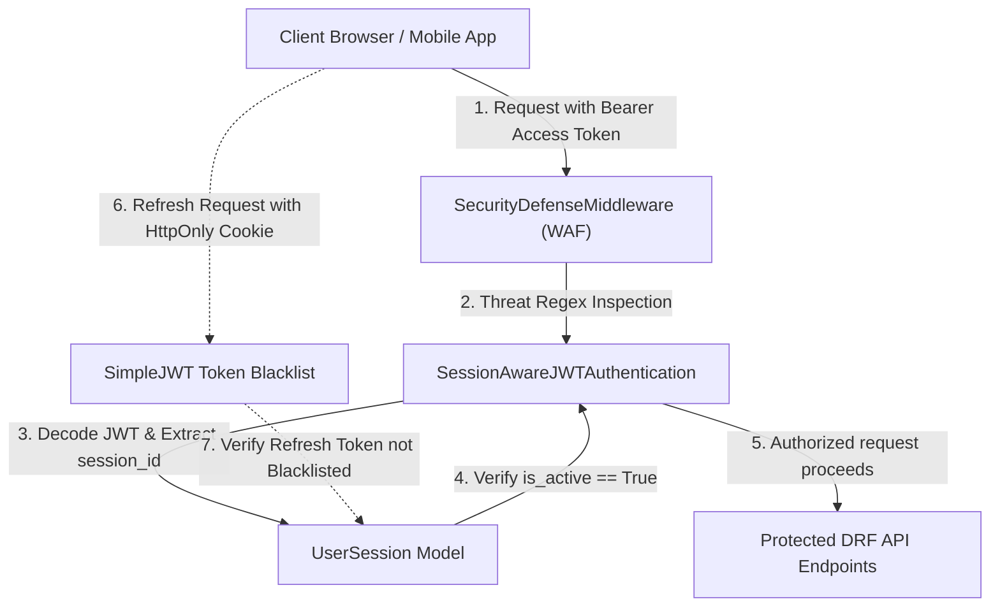

# MONVEX SECURITY ARCHITECTURE SPECIFICATION
**Subsystem:** Cyber Defense & Security Center (`/security`)  
**Architecture Pattern:** Zero-Trust Perimeter Defense & Server-Side Session Isolation  
**Classification:** Core Security Engineering Documentation  
**Version:** 3.4.0  

---

## 1. Authentication Architecture & Token Lifecycle

MONVEX implements a defense-in-depth authentication framework marrying cryptographic stateless access tokens with an authoritative, stateful server-side session registry.



### 1.1 Token Topography
- **Access Tokens:** Short-lived HMAC-SHA256 JSON Web Tokens with a 60-minute Time-To-Live (`ACCESS_TOKEN_LIFETIME = timedelta(seconds=3600)`).
  - Claims: `user_id`, `jti`, `exp`, `iat`, and custom claim `session_id`.
  - Transmission: Sent in the standard `Authorization: Bearer <token>` HTTP header.
- **Refresh Tokens:** Long-lived rotating cryptographic tokens with a 7-day TTL (`REFRESH_TOKEN_LIFETIME = timedelta(days=7)`).
  - Storage: Transmitted and held in an HttpOnly, SameSite=Lax cookie (`monvex_refresh_token`).
  - Rotation: `ROTATE_REFRESH_TOKENS = True` and `BLACKLIST_AFTER_ROTATION = True`. Every refresh exchange invalidates the incoming refresh token into the blacklist and issues a new token pair.

---

## 2. Server-Side Session Registry & Identification

### 2.1 The `UserSession` Entity
To solve the security vulnerability of pure stateless JWTs (where revoking a session does not invalidate issued access tokens), MONVEX binds all issued tokens to an authoritative server-side `UserSession` record (`apps.security.models.UserSession`):

```python
class UserSession(models.Model):
    id = models.UUIDField(primary_key=True, default=uuid.uuid4, editable=False)
    user = models.ForeignKey(User, on_delete=models.CASCADE, related_name='user_sessions')
    session_key = models.CharField(max_length=255, blank=True, default='')
    refresh_jti = models.CharField(max_length=255, blank=True, default='', db_index=True)
    access_jti = models.CharField(max_length=255, blank=True, default='', db_index=True)
    ip_address = models.CharField(max_length=64, default='127.0.0.1')
    user_agent = models.TextField(blank=True, default='')
    device_name = models.CharField(max_length=150, default='Web Browser')
    is_active = models.BooleanField(default=True, db_index=True)
    created_at = models.DateTimeField(auto_now_add=True)
    last_activity = models.DateTimeField(auto_now=True)
    revoked_at = models.DateTimeField(null=True, blank=True)
```

### 2.2 Session Identification & Binding
1. **Creation:** At registration, credential login, or MFA challenge verification (`apps.security.session_utils.issue_session_tokens`), a new `UserSession` is committed to the database. The session's primary key (`session.id`) is embedded into both the `RefreshToken` and `AccessToken` claims (`token['session_id'] = str(session.id)`).
2. **Resolution:** When an authenticated request arrives, the server resolves the caller's active session by checking:
   - Claim `request.auth.payload['session_id']`.
   - Matching `request.COOKIES['monvex_refresh_token']` with `UserSession.refresh_jti`.
   - Matching `request.auth.payload['jti']` with `UserSession.access_jti`.
   - Caller IP and user agent fallback registration for legacy tokens.

---

## 3. Session Revocation Guarantees ("Revoke Other Sessions")

### 3.1 Revocation Mechanics
When the user executes **"Revoke Other Sessions"** (`POST /api/v1/security/revoke-sessions/`):

1. **Caller Isolation:** The caller's current session is authoritatively identified via `resolve_current_session(request, user)`.
2. **Atomic Invalidation:** Inside an atomic database transaction:
   - All other active sessions for this user (`UserSession.objects.filter(user=user, is_active=True).exclude(id=current_session.id)`) are updated:
     - `is_active = False`
     - `revoked_at = timezone.now()`
   - All other outstanding refresh tokens belonging to the user (excluding `current_session.refresh_jti`) are immediately committed to `rest_framework_simplejwt.token_blacklist.models.BlacklistedToken`.
3. **Audit Trail:** An immutable `SecurityAuditLog` event is generated with `event_type='SESSION_REVOKED'` recording the exact number of revoked sessions and the preserved caller ID.

### 3.2 Security Enforcement Guarantees
- **Immediate Access Token Rejection:** `apps.security.authentication.SessionAwareJWTAuthentication` intercepts every authenticated API request. When an access token bearing a revoked `session_id` is presented, it queries `UserSession.objects.filter(id=session_id, user=user)`. If `is_active == False`, the request is instantly rejected with `401 Unauthorized` (`"Session has been revoked or expired."`).
- **Refresh Token Rejection:** Any attempt by a revoked device to trade its refresh token for a new access token at `/api/v1/auth/token/refresh/` fails with `401 Unauthorized` (`"Token is blacklisted"`).
- **Caller Session Continuity:** The caller's own `UserSession` and refresh token remain unblacklisted, allowing uninterrupted continued usage.
- **Cross-User Tenant Isolation:** Queries are strictly scoped to `request.user`. No user can inspect or revoke sessions belonging to any other user.

---

## 4. Real Security Scanning Engine (`SecurityScanner`)

The MONVEX Security Scanner (`apps.security.scanner.SecurityScanner`) executes real, non-fabricated diagnostic inspections against the live running environment:

| Check ID | Check Name | Verified Target | Category | Weight |
| :--- | :--- | :--- | :--- | :--- |
| `CHK-DEBUG` | Production Debug Mode | `settings.DEBUG == False` | Configuration | 6 |
| `CHK-SECRET-KEY` | Secret Key Entropy | Length >= 32, non-default entropy | Cryptography | 10 |
| `CHK-ALLOWED-HOSTS` | Host Header Guard | Bounded domains, no wildcard in prod | Network | 6 |
| `CHK-SECURE-COOKIES` | Cookie Security Flags | `HttpOnly`, `SameSite=Lax/Strict` | Session | 6 |
| `CHK-CSRF-PROTECTION` | Anti-Forgery Middleware | `CsrfViewMiddleware` active in pipeline | Application | 10 |
| `CHK-CORS-ORIGINS` | CORS Boundaries | `CorsMiddleware` active, discrete origins | Network | 4 |
| `CHK-SECURITY-HEADERS` | Security Headers & Frame Guard | `X-Frame-Options: DENY`, `SecurityMiddleware` | Network | 6 |
| `CHK-TOKEN-ROTATION` | Zero-Trust Token Rotation | `ROTATE_REFRESH_TOKENS`, `token_blacklist` | Authentication | 10 |
| `CHK-RATE-LIMITING` | Anti-Brute Force Throttling | DRF anon (120/min) & user (1200/hr) throttles | Application | 6 |
| `CHK-PASSWORD-HASHING` | Cryptographic Password Hashing | Argon2 / PBKDF2 hasher presence | Authentication | 6 |
| `CHK-WAF-INTRUSION-PREVENTION` | Active Defense WAF | `SecurityDefenseMiddleware` injection shield | Application | 10 |
| `CHK-AUDIT-PERSISTENCE` | SHA-256 Audit Trail | `SecurityAuditLog` hash chain integrity | Audit | 10 |
| `CHK-DATABASE-INTEGRITY` | Database ACID Isolation | `connection.cursor()` healthy query | Infrastructure | 10 |

### 4.1 Health Score Calculation Formula
$$\text{Score} = \left( \frac{\sum \text{Earned Points}}{\sum \text{Total Possible Points}} \right) \times 100$$
- `PASS`: 100% of check weight.
- `WARNING`: 65% of check weight.
- `FAIL` / `UNKNOWN`: 0% of check weight.

---

## 5. Tamper-Evident Audit Logging (SHA-256 Hash Chaining)

Each `SecurityAuditLog` record forms an immutable node in a cryptographic SHA-256 hash chain:

$$H_i = \text{SHA256}(H_{i-1} \,\|\, \text{id}_i \,\|\, \text{event\_type}_i \,\|\, \text{severity}_i \,\|\, \text{ip}_i \,\|\, \text{created\_at}_i \,\|\, \text{description}_i)$$

- `prev_hash`: Holds the hash of the preceding record ($H_{i-1}$).
- `hash`: Holds the authoritative hash ($H_i$) calculated across all canonical payload attributes.
- **Verification Utility:** `verify_audit_log_chain(user=None)` executes link-by-link integrity validation and payload recomputation, reporting any database tampering (`HASH_PAYLOAD_TAMPERED`) or deleted records (`PREVIOUS_HASH_CHAIN_MISMATCH`).
